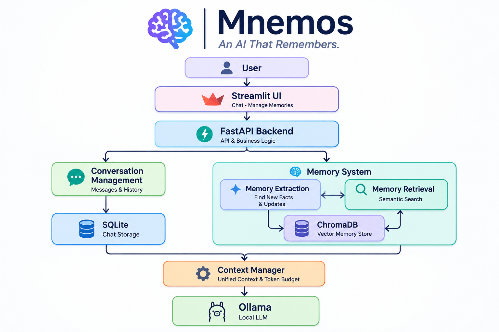
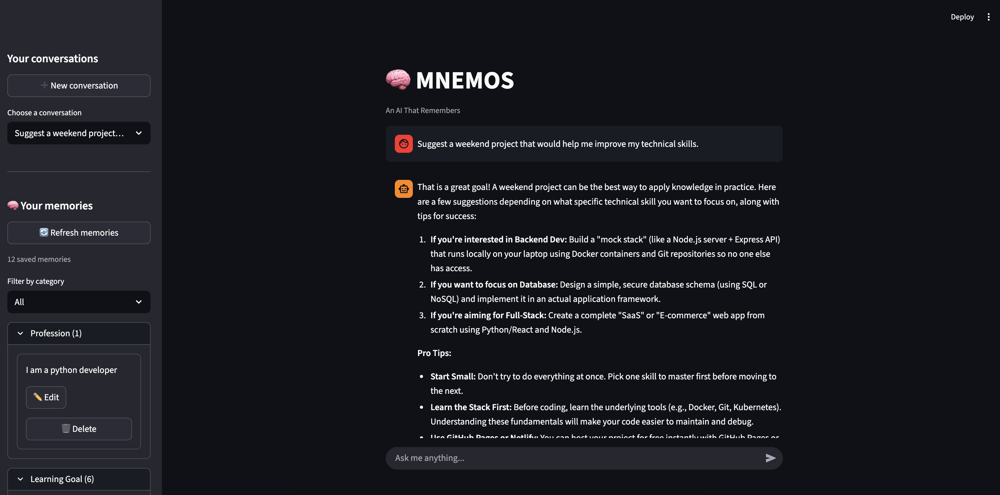

# Mnemos 🧠
### An AI That Remembers.

**Mnemos** is a persistent-memory AI chatbot that remembers important information across conversations and uses it to deliver personalized, context-aware responses.

Built with Python, FastAPI, Ollama, and ChromaDB, Mnemos combines conversational history with semantic long-term memory. It can extract new facts, retrieve relevant memories, recognize explicit corrections, and allow users to manage their stored information.

Unlike traditional chatbots that primarily rely on the current conversation context, Mnemos is designed to retain useful knowledge over time.

---

## ✨ Features

- **Conversational AI:** Chat with a locally hosted LLM using Ollama.
- **Persistent Memory:** Extract and store stable user information across conversations.
- **Semantic Retrieval:** Find relevant memories using vector embeddings and similarity search.
- **Memory Reconciliation:** Add new facts and update existing memories when users explicitly correct information.
- **Context Management:** Combine recent conversation history and relevant memories while managing token budgets.
- **Memory Management:** Browse, categorize, edit, filter, and delete stored memories.
- **Persistent Conversations:** Save conversation history using SQLite.
- **REST API:** Backend powered by FastAPI with request validation and error handling.

---

## 🏗️ Architecture

Mnemos follows a modular architecture that separates conversation management, memory processing, context construction, and LLM inference.




### Message processing flow

1. Receive a user message through the Streamlit interface.
2. Save the message and retrieve conversation history.
3. Extract stable facts and reconcile them with existing memories.
4. Retrieve relevant memories from ChromaDB using semantic search.
5. Build a unified context using conversation history, retrieved memories, and token budgeting.
6. Generate a response using the local LLM.
7. Save and return the assistant's response.

---

## 📸 Screenshots

### Chat Interface



---

## 🛠️ Tech Stack

| Technology | Purpose |
|---|---|
| Python | Core application |
| FastAPI | Backend REST API |
| Streamlit | Frontend interface |
| Ollama | Local LLM inference |
| Qwen 3.5 (0.8B) | Language model |
| SQLite | Conversation persistence |
| SQLAlchemy | Database ORM |
| ChromaDB | Long-term vector memory |
| Sentence Transformers | Text embeddings |
| all-MiniLM-L6-v2 | Embedding model |
| tiktoken | Token estimation |
| Pydantic | Request validation |

---

## 📁 Project Structure

```text
mnemos/
│
├── backend/
│   ├── main.py
│   ├── config.py
│   ├── database.py
│   ├── memory.py
│   ├── long_term_memory.py
│   ├── memory_extraction.py
│   ├── context_manager.py
│   │
│   └── prompts/
│       └── memory_extraction.txt
│
├── frontend/
│   └── app.py
│
├── requirements.txt
├── .gitignore
└── README.md
```

---

## 🚀 Getting Started

### Prerequisites

- Python 3.9+
- [Ollama](https://ollama.com/)

### 1. Clone the repository

```bash
git clone https://github.com/YOUR_USERNAME/mnemos.git
cd mnemos
```

### 2. Create and activate a virtual environment

**macOS / Linux**

```bash
python3 -m venv .venv
source .venv/bin/activate
```

**Windows**

```bash
python -m venv .venv
.venv\Scripts\activate
```

### 3. Install dependencies

```bash
pip install -r requirements.txt
```

### 4. Download the language model

```bash
ollama pull qwen3.5:0.8b
```

Ensure the Ollama service is running.

### 5. Start the backend

```bash
uvicorn backend.main:app --reload
```

Backend: http://127.0.0.1:8000

API documentation: http://127.0.0.1:8000/docs

### 6. Start the frontend

Open another terminal, activate the virtual environment, and run:

```bash
streamlit run frontend/app.py
```

Frontend: http://localhost:8501

---

## 🔌 API Reference

| Method | Endpoint | Description |
|---|---|---|
| POST | `/conversations` | Create a conversation |
| GET | `/conversations` | List conversations |
| GET | `/conversations/{id}/messages` | Retrieve conversation history |
| POST | `/chat` | Send a message and generate a response |
| GET | `/memories` | Retrieve stored memories |
| PUT | `/memories/{id}` | Update a memory |
| DELETE | `/memories/{id}` | Delete a memory |

Interactive API documentation is available through FastAPI Swagger UI at `/docs`.

---

## 🧪 Testing

The application has been tested across its primary workflows:

- Conversation creation and persistence.
- AI response generation.
- Memory extraction and storage.
- Cross-conversation memory retrieval.
- Explicit memory correction and updates.
- Manual memory editing and deletion.
- Memory categorization and filtering.
- Invalid conversation handling.
- Ollama failure handling and recovery.

All core end-to-end tests passed during development.

---

## 🔮 Future Improvements

- Multi-user authentication and memory isolation.
- Improved fact-conflict detection and memory reconciliation.
- Memory importance scoring and expiration.
- Memory provenance and change history.
- Hybrid retrieval combining semantic and keyword search.
- Automated evaluation of memory extraction and retrieval quality.
- Streaming responses and Docker deployment.

---

## 👨‍💻 Author

**Aditya Neel**

GitHub: [adityaneel-lab](https://github.com/adityaneel-lab)

---

*Mnemos — Not just a chatbot. An AI that remembers.* 🧠